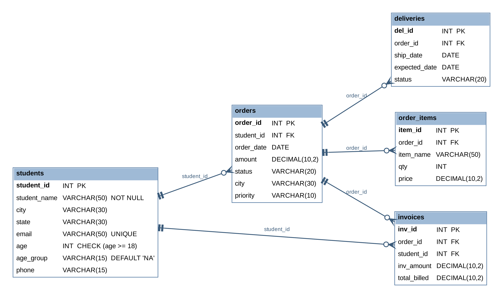

# CIA 2 – SQL Queries on `merchdb`

**Diksha Pandey · Reg. No. 25121016 · MBA (Business Analytics), CHRIST (Deemed to be University), Pune Lavasa Campus**

A MySQL database for a campus merchandise store (students, orders, order items, invoices, deliveries), used to demonstrate DDL and DML queries.

## Files
| File | Contents |
|---|---|
| `merchdb_CIA2.sql` | Complete SQL script, in execution order |
| `er_diagram.png` | ER diagram of the schema |
| `csv/students.csv` | students table (18 rows) |
| `csv/orders.csv` | orders table (10 rows) |
| `csv/order_items.csv` | order_items table (17 rows) |
| `csv/invoices.csv` | invoices table (12 rows) |
| `csv/deliveries.csv` | deliveries table (10 rows) |

## Queries covered
1. CREATE TABLE with PRIMARY KEY, NOT NULL, CHECK, DEFAULT
2. ALTER TABLE – add a column
3. ALTER TABLE – add a UNIQUE constraint
4. UPDATE with CASE
5. UPDATE multiple rows with a condition
6. UPDATE with a correlated subquery (SUM)
7. UPDATE with a multi-branch CASE
8. UPDATE with JOIN
9. UPDATE with a GROUP BY aggregate (derived table)
10. UPDATE with DATE_ADD date arithmetic

**Tools:** MySQL 8.0, MySQL Workbench

